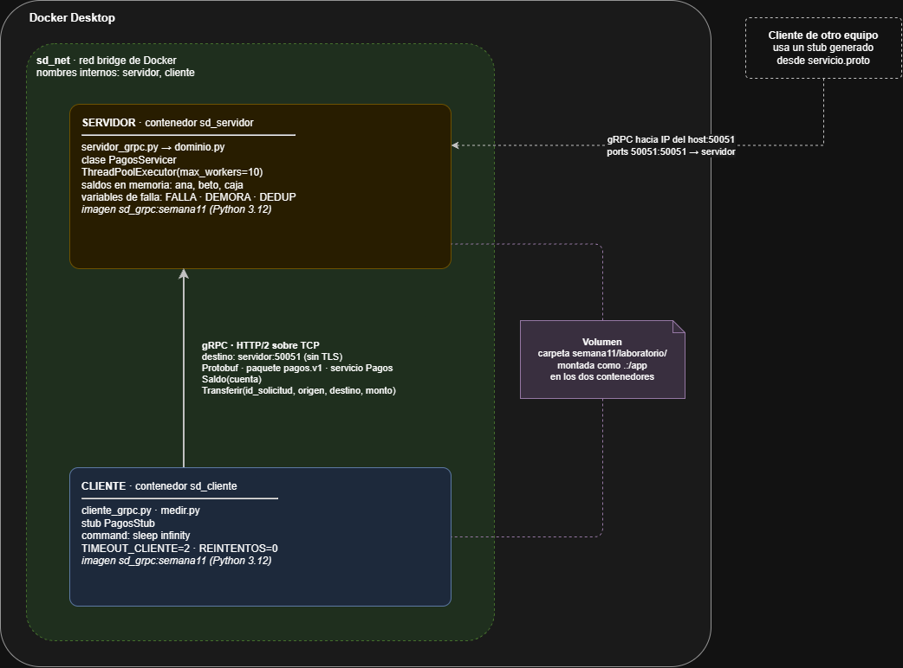

# Reporte de Servicios Cliente-Servidor

**Equipo** pagos  
**Integrantes** Diego Leiva y Alan Gimilio  
**Dominio** Pagos electrónicos (Webpay / Transbank)  
**Repositorio** <https://github.com/AlanGWi/Sistemas_Distribuidos>  
**Fecha** 20-11-2026

## 1. El servicio y su dominio

Nuestro dominio corresponde a **pagos electrónicos**. Partimos de la investigación sobre Webpay y Transbank (`carpeta docs/investigacion/`) y la llevamos a una versión simplificada en Docker: un servicio de saldos y transferencias que funciona como el núcleo de cuentas de una billetera digital. Quien paga necesita mover dinero desde su cuenta hacia la de un comercio, y ambos necesitan consultar cuánto tienen disponible. Por otra parte, el servicio debe garantizar que el dinero no se cree ni se pierda en el camino.

La lógica del negocio está en `dominio.py` (`semana11/laboratorio/dominio.py`, el mismo archivo que usa `semana12/`):

| Operación | Descripción | ¿Cambia estado? |
| --- | --- | --- |
| `saldo(cuenta)` | Devuelve el saldo actual de la cuenta. Si no existe, responde `CUENTA_NO_EXISTE`. | No. |
| `transferir(origen, destino, monto)` | Resta el monto del origen y lo suma al destino dentro de una sección crítica protegida con `Lock`. Puede fallar con `SALDO_INSUFICIENTE`, `MISMA_CUENTA` o `CUENTA_NO_EXISTE`. | Sí, modifica los saldos de las dos cuentas. |

Las cuentas parten con `ana` en 100.000, `beto` en 20.000 y `caja` en 0, y los saldos se mantienen en memoria. Los montos son enteros positivos en pesos. Una transferencia conserva la suma total de los saldos, mientras que `DEPOSITAR` y `RETIRAR`, que existían en el protocolo de texto de la semana 6 (`semana06/semana06/laboratorio/protocolo.md`), sí la modificaban.

## 2. Arquitectura y topología



El diagrama representa el despliegue de `semana11/laboratorio/docker-compose.yml`, que corresponde al mecanismo elegido en la sección 4. Ambos contenedores se construyen desde la misma imagen `sd_grpc:semana11` (Python 3.12 y `grpcio` 1.80) y comparten la red `sd_net`. El código se monta como volumen (`.:/app`), así que los cambios en los `.py` se ven sin reconstruir la imagen.

| Nodo | Función en el sistema | Puerto y protocolo |
| --- | --- | --- |
| `servidor` (`sd_servidor`) | Ejecuta `servidor_grpc.py`. La clase `PagosServicer` recibe las llamadas y las delega a `dominio.py`. Usa un `ThreadPoolExecutor` de 10 hilos y guarda los saldos en memoria. Con `FALLA`, `DEMORA` y `DEDUP` se provocan las fallas de la semana 11. | gRPC en `0.0.0.0:50051`, publicado al host como `50051:50051`. |
| `cliente` (`sd_cliente`) | No ofrece un servicio propio (`sleep infinity`). Lo usamos para ejecutar `cliente_grpc.py` y `medir.py` mediante el stub `PagosStub`. | Canal gRPC sin TLS hacia `servidor:50051`, con `TIMEOUT_CLIENTE=2` y `REINTENTOS=0`. |
| Host | Es el notebook que ejecuta Docker. Como el puerto está publicado, otro equipo puede conectarse desde fuera. | `localhost:50051` |

En este despliegue no hay servidor de nombres: el cliente llega al servidor escribiendo `servidor`, y el DNS de Docker dentro de `sd_net` traduce ese nombre a la IP del contenedor. Los mensajes viajan en Protocol Buffers sobre HTTP/2, según el contrato `proto/servicio.proto` (paquete `pagos.v1`, servicio `Pagos`).

## 3. Evolución del contrato

Para comparar las etapas usamos siempre la misma consulta: el saldo de la cuenta `ana`. En la semana 4 el servicio todavía no era de pagos, por lo que se muestra la operación propia que agregamos ese día.

| Etapa | Semana | Dónde está el contrato | Ejemplo de la misma operación |
|---|---|---|---|
| Protocolo de texto sobre TCP | 4 y 6 | `protocolo.md` (`Semana4/semana04/` y `semana06/semana06/laboratorio/`) | S4: `SUMA 3 4` → `OK 7`. S6: `SALDO ana` → `OK ana 100000` |
| REST | 7 | `api.py` (`semana07/laboratorio/`) | `GET /cuentas/ana` → `{"cuenta": "ana", "saldo": 100000, "replica": "api1"}` |
| Mensajes estructurados | 9 | `protocolo.md` v3 (`semana09/laboratorio/`) | 4 bytes de largo + `{"operacion": "SALDO", "argumentos": ["ana"], "id": 1, "version": 2}` → `OK ana \| 100000` |
| JSON-RPC | 10 | `rpc.py` (`semana10/`) | `{"jsonrpc":"2.0","method":"saldo","params":{"cuenta":"ana"},"id":1}` → `{"jsonrpc":"2.0","result":{"cuenta":"ana","saldo":99500},"id":1}` |
| gRPC | 11 | `.proto` (`semana11/laboratorio/proto/servicio.proto`) | `stub.Saldo(SaldoSolicitud(cuenta="ana"), timeout=2)` → `SaldoRespuesta{cuenta: "ana", saldo: 100000}` |
| Objetos remotos | 12 | `objetos.py` (`semana12/`) | `proxy.saldo("ana")` → `{'cuenta': 'ana', 'saldo': 100000}` |

El valor del saldo depende de las pruebas que se hicieron antes en cada semana. La respuesta de JSON-RPC está tomada de `semana10/pruebas.md`, y la de REST sigue el formato que arma `api.py`.

Cada cambio de mecanismo trajo mejoras, pero también costos:

| Cambio | Lo que ganamos | Lo que perdimos |
| --- | --- | --- |
| Inicio: texto sobre TCP (4 y 6) | Un protocolo que se escribe y se prueba directamente en la terminal. En la semana 6 se sumaron el hilo por cliente, las operaciones de pagos y errores con nombre propio, como `SALDO_INSUFICIENTE`. | No hay tipos: el monto llega como texto y el servidor tiene que revisar que solo tenga dígitos. Tampoco existen `id` ni versión. |
| Texto → REST (7) | Rutas HTTP para cada recurso (`/cuentas/{cuenta}`, `/transferencias`), códigos HTTP conocidos y dos réplicas de la API balanceadas por Nginx. | Un salto más en cada petición, porque la API traduce a TCP. Los saldos siguen en un solo servidor, por lo que replicar la API no replica los datos. |
| REST → mensajes estructurados (9) | Mensajes enmarcados por largo, con `version` e `id`, y un codec binario que en 10.000 mensajes ocupó un 69 % menos en solicitudes y un 67 % menos en respuestas (`semana09/laboratorio/observaciones.md`). | Los bytes del codec binario no se pueden leer a simple vista, y cliente y servidor deben conocer el esquema. |
| Estructurados → JSON-RPC (10) | Un estándar ya definido, con `id`, códigos de error (-32601, -32602 y -32000), lotes y notificaciones, probados en `semana10/pruebas.md`. | Sin IDL no hay tipos en el contrato, así que `dominio.py` sigue validando a mano que el monto sea entero. |
| JSON-RPC → gRPC (11) | El monto pasa a ser `int64` en el contrato. Además, los stubs se generan solos, cada llamada tiene deadline y códigos de estado, y `Transferir` incorpora `id_solicitud` para reconocer reintentos. | Ya no se puede probar con `curl.exe` porque el mensaje es binario, y cada cambio al `.proto` obliga a correr `generar.sh`. |
| gRPC → objetos remotos (12) | La `Transaccion` como objeto con estado propio (`pendiente`, confirmada o cancelada) que viaja por referencia, y la búsqueda del servicio por nombre (`sd.pagos.pasarela`). | Pyro5 funciona solo con Python y no trae deadlines del lado del servidor ni deduplicación. Además, `nombres` se vuelve un nodo crítico y aparecen las referencias colgantes (`DaemonError: unknown object`). |

## 4. Mecanismo elegido y justificación

El mecanismo con el que nos quedamos para la presentación del 4-12 es **gRPC**, implementado en `semana11/laboratorio/`. Esta elección es coherente con lo que ya habíamos concluido en el cuadro comparativo de la semana 10, donde escribimos que "para un servicio interno elegiríamos gRPC por su eficiencia y sus contratos definidos" (`semana10/cuadro_comparativo.md`).

El argumento principal viene de las transferencias. En un sistema de pagos, el peor error es que una misma transferencia se aplique dos veces porque el cliente reintentó después de perder la respuesta. En la semana 11 comprobamos que, sin protección, eso efectivamente ocurre: con tres intentos, la cuenta de `ana` perdió 1.500 en lugar de 500. En cambio, con `id_solicitud` y `DEDUP=1`, el servidor reconoció el reintento y devolvió la respuesta guardada sin volver a mover el dinero (`semana11/laboratorio/observaciones.md`, casos 3 y 4). **Este mecanismo solo lo tenemos implementado y probado en gRPC.**

Además, el contrato de gRPC define el monto como `int64`, de modo que el propio mensaje impide enviar un monto con decimales o en texto. En JSON-RPC y en Pyro5, esa responsabilidad queda completamente en `dominio.py`. Por otra parte, cada llamada tiene un deadline, así que el cliente no se queda bloqueado esperando: recibe `DEADLINE_EXCEEDED` o `UNAVAILABLE` y puede decidir si reintenta con el mismo `id_solicitud`. Por último, una pasarela de pagos atiende a comercios con sistemas en distintos lenguajes, y a partir del `.proto` se pueden generar stubs para cada uno, algo que Pyro5 no permite.

| Criterio | gRPC (elegido) | JSON-RPC 2.0 | Pyro5 |
| --- | --- | --- | --- |
| Modelo | Procedimientos remotos del servicio `Pagos` | Procedimientos remotos por nombre | Objetos remotos `Pasarela` y `Transaccion` |
| Contrato o IDL | `.proto` con tipos, monto `int64` | Sin IDL; métodos registrados en `METODOS` | Sin IDL; la interfaz es `objetos.py` |
| Transporte y formato | HTTP/2 sobre TCP, Protobuf | HTTP con JSON | TCP con el protocolo de Pyro5, `serpent` |
| Lenguajes | Varios lenguajes a partir del `.proto` | Cualquier lenguaje que maneje JSON | Solo Python |
| Estado y referencias | El estado vive en el servidor, sin referencias | Sin referencias remotas | `Transaccion` por referencia; se pierde al reiniciar el servidor |
| Errores del dominio | `FAILED_PRECONDITION` (por ejemplo, `SALDO_INSUFICIENTE`) | Código `-32000` con el detalle en `data` | Excepción remota registrada con `register_dict_to_class` |
| Reintento de una transferencia | Seguro con `id_solicitud` y `DEDUP` | Sin deduplicación | Sin deduplicación |
| Tiempo máximo de espera | Deadline en cada llamada | Timeout del cliente HTTP | `_pyroTimeout = 5`, solo en el cliente |
| Descubrimiento del servidor | DNS de Docker (`servidor:50051`) | URL fija | Servidor de nombres `nombres` |

Al elegir gRPC, la mayor pérdida es el objeto `Transaccion` de la semana 12, que representaba de forma natural una transacción pendiente con su propio ciclo de vida. En gRPC tendríamos que reemplazarlo por un identificador y una tabla en el servidor. También perdemos la comodidad de depurar con `curl.exe`, como hacíamos con JSON-RPC. Aun así, consideramos que en pagos es más importante no duplicar transferencias. Además, la `Transaccion` de Pyro5 tampoco resolvía la persistencia: en la semana 12, una transacción pendiente quedó como referencia colgante después de reiniciar el servidor.

## 5. Evidencia de funcionamiento y medición

Evidencia entre contenedores: en `semana11/laboratorio/observaciones.md` quedaron los registros del servidor cuando el cliente, desde `sd_cliente`, envió una transferencia con `FALLA=siempre` y `DEDUP=1`:

```text
[servidor] Transferir id=4ae32650 -> {'origen': 'ana', 'saldo_origen': 99500, 'destino': 'beto', 'saldo_destino': 20500}
[servidor] FALLA=siempre, cambio YA aplicado, demoro la respuesta 3 s
[servidor] Transferir id=4ae32650 repetido, devuelvo lo guardado SIN aplicar de nuevo
```

En esa misma observación también registramos, desde `sd_cliente` hacia `sd_servidor`, los cinco códigos de error de gRPC: `UNIMPLEMENTED`, `INVALID_ARGUMENT`, `FAILED_PRECONDITION`, `UNAVAILABLE` y `DEADLINE_EXCEEDED`.

Comandos de la medición:

```bash
# gRPC, en semana11/laboratorio/ (medir.py con las tres líneas EDITAR ajustadas a Saldo)
docker compose up -d --build
docker compose exec cliente python medir.py grpc --metodo saldo
docker compose down
# Pyro5, en semana12/
docker compose up -d --build
docker compose exec cliente bash
python medir.py pyro --metodo saldo --params '{"cuenta": "ana"}' --nombre sd.pagos.pasarela
```

Medición con `medir.py`, la misma operación de consulta sobre el mecanismo elegido y sobre una alternativa

| Mecanismo | Operación | n | p50 ms | p95 ms | media ms | máx ms | respuesta bytes |
|---|---|---|---|---|---|---|---|
| grpc | saldo | 200 | 0.65 | 0.73 | 0.66 | 1.06 | 9 |
| pyro | saldo | 200 | 0.21 | 0.27 | 0.22 | 0.39 | 57 |

En ambos casos se consultó el saldo de `ana` (`dominio.saldo("ana")`), operación que no cambia el estado. La fila de gRPC también quedó guardada en `semana11/laboratorio/mediciones.csv`.

Los resultados no favorecen al mismo mecanismo en las dos columnas. Pyro5 respondió más rápido, con una mediana de 0,21 ms contra 0,65 ms de gRPC, es decir, cerca de tres veces menos. En cambio, la respuesta de gRPC pesó apenas 9 bytes, mientras que la de Pyro5 llegó a 57.

El tamaño tiene una explicación directa. Protobuf codifica la respuesta como dos campos numerados en binario, donde `"ana"` ocupa 5 bytes y el entero `100000` ocupa 4. En cambio, `serpent` transforma el diccionario en texto, con las palabras `'cuenta'` y `'saldo'` incluidas, y le antepone una línea de encabezado. Esto coincide con lo que ya habíamos visto en la semana 9, cuando el codec binario ahorró alrededor de un 69 % frente a JSON.

Sobre la latencia, creemos que el costo adicional de gRPC viene de HTTP/2, porque cada llamada lleva sus propios frames de cabeceras, datos y estado final. Pyro5, en cambio, escribe un mensaje más sencillo sobre un socket que ya estaba abierto. **No medimos cada componente por separado, así que esta explicación es una hipótesis.** Además, hay que considerar que `medir.py` solo cuenta los datos útiles de la respuesta, sin las cabeceras de los protocolos.

En nuestro dominio, estos 0,44 ms de diferencia no son determinantes. Un pago real involucra al comercio, a la pasarela y al banco, y cada una de esas validaciones tarda mucho más que lo medido aquí. Lo que sí es determinante es evitar transferencias duplicadas, y para eso la elección sigue siendo gRPC.

## 6. Análisis de fallos

| Falla provocada | Qué esperaban según la teoría | Qué observaron | Qué harían para tolerarla |
| --- | --- | --- | --- |
| Servidor cae a mitad de una llamada (semana 11) | Que el cliente quede sin saber si la transferencia alcanzó a aplicarse, porque puede fallar antes de ejecutarse, después de ejecutarse o al enviar la respuesta. | Al matar el servidor durante la llamada, el cliente recibió `UNAVAILABLE, Socket closed`, y al reiniciar los saldos volvieron a 100.000 y 20.000 (caso 5). Con `FALLA=siempre`, el cliente vio `DEADLINE_EXCEEDED`, **pero la transferencia sí se había aplicado** (caso 2). | Reintentar con el mismo `id_solicitud`, mantener `DEDUP=1` y guardar los identificadores y los saldos en almacenamiento persistente. |
| Servidor cae y vuelve (semana 12) | Que el proxy pueda reconectarse a la misma URI, pero que se pierda todo lo que estaba en memoria: saldos y objetos del daemon. | `vigilar` detectó `ConnectionClosedError`, mostró `reconectado` y siguió consultando sin reiniciarse. Los saldos volvieron de 99.500 y 20.500 a 100.000 y 20.000. Una `Transaccion` que estaba pendiente quedó como referencia colgante (`unknown object`). | Persistir saldos, transacciones e identificadores de solicitud, para recuperar una transacción pendiente después del reinicio. |
| Servidor de nombres cae (semana 12) | Que los clientes ya conectados sigan operando, que los nuevos no puedan encontrar el servicio y que, si `nombres` vuelve vacío, el nombre no exista hasta registrarlo otra vez. | Se cumplió lo esperado. `vigilar` siguió consultando, un cliente nuevo recibió `Failed to locate the nameserver` y, con `nombres` de vuelta, `unknown name`, hasta que se reinició `servidor`. | Activar `REREGISTRO=5` (**explicado a partir del código, no probado en la terminal**) o usar un servicio de nombres tolerante a fallas. |

En la semana 11 clasificamos los casos con estos nombres: *Maybe* sin reintentos, *At-least-once* con reintentos sin `DEDUP` y *At-most-once* con `DEDUP=1`. La configuración por defecto de nuestro servicio (`REINTENTOS=0`) corresponde a **como máximo una vez**: se hace un solo intento y, si vence el deadline, el cliente no puede saber si la transferencia ocurrió. El caso 2 demuestra que puede haber ocurrido aunque el cliente vea un error. Si se activan los reintentos sin `DEDUP`, el servicio pasa a **al menos una vez**, y el caso 3 muestra el efecto en dinero: `ana` quedó en 98.500 en vez de 99.500. Con `DEDUP=1`, la transferencia se aplicó una sola vez (caso 4). Sin embargo, la tabla `_vistas` vive en memoria, así que esa protección desaparece si el servidor se reinicia.

Un sistema de pagos necesita que cada transferencia tenga efecto **exactamente una vez**. Una transferencia repetida mueve dinero de más, y una perdida deja al cliente sin saber si pagó. Para lograrlo hay que combinar reintentos (al menos una vez) con `id_solicitud` y una deduplicación que sobreviva a los reinicios. La consulta de `saldo`, por otra parte, puede repetirse sin consecuencias, porque solo lee. **La deduplicación persistente es una mejora propuesta; hoy solo existe en memoria.**

## 7. Referencias

1. Tanenbaum, A. y van Steen, M. (2017). Distributed Systems, 3.ª edición. Capítulo 4 (Communication) y capítulo 8, sección 8.3 (Reliable client-server communication). Bibliografía del curso.
2. Coulouris, G., Dollimore, J. y Kindberg, T. (2001). Sistemas distribuidos: conceptos y diseño, 3.ª edición. Addison-Wesley. Capítulo 5 (Objetos distribuidos e invocación remota). Bibliografía del curso.
3. gRPC Authors (s. f.). Core concepts, architecture and lifecycle. https://grpc.io/docs/guides/concepts/
4. gRPC Authors (s. f.). Status codes. https://grpc.io/docs/guides/status-codes/
5. de Jong, I. (s. f.). Pyro5 documentation. https://pyro5.readthedocs.io/
6. JSON-RPC Working Group (2010, actualización de 2013). JSON-RPC 2.0 Specification. https://www.jsonrpc.org/specification
